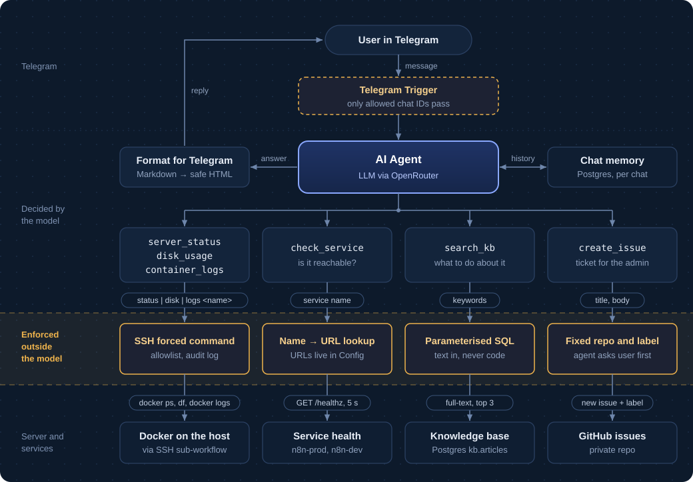

# 01 · IT support AI agent

A Telegram bot that works as first-line IT support for a Linux server running services in Docker. It does not guess: before answering, it checks the server with its own tools, looks up the team's instructions in a knowledge base, and opens a GitHub issue for the administrator when the problem needs a human — after asking the user first.

Built in n8n, deployed from Git to a self-hosted n8n by CI.

> **Demo:** _link to the demo video_

## What it does

```text
User:  i can not connect to service
Bot:   Which service are you unable to connect to: n8n-prod or n8n-dev?
User:  stack
Bot:   The service is responding normally (HTTP 200 OK). Could you describe
       what exactly happens when you try to connect?
User:  my browser dont open page
Bot:   The container logs show the service is running at https://pipe.xdev.club
       and the health check returned 200 OK, so the server side is fine.
       Try an Incognito window or clearing the cache. If it still fails,
       send me the exact error you see.
User:  create a ticket
Bot:   Title: Unable to access n8n-prod in browser
       Details: User reports the page won't open. check_service returned 200 OK
       and container logs look normal. Suspected network or DNS issue.
       Should I go ahead and create the ticket?
User:  yes
Bot:   The ticket has been created: https://github.com/<owner>/<tickets-repo>/issues/2
```

The agent replies in the user's language; the knowledge base and tool descriptions are in English.

## Architecture



### Tools

| Tool | What it does | How it is constrained |
|---|---|---|
| `server_status` | uptime, load, all containers with status | fixed command |
| `disk_usage` | disk usage without tmpfs/overlay | fixed command |
| `container_logs` | last 50 log lines of one container | the model passes only a container name; the wrapper validates it |
| `check_service` | HTTP health check, returns the status code | the model picks a service **name**; URLs live in the `Config` node |
| `search_kb` | full-text search over support instructions | fixed SQL, the model's text is a query parameter |
| `create_issue` | opens a GitHub issue labelled `support-bot` | repo and label fixed; only after the user agrees |

All three SSH tools call one sub-workflow (`ssh-runner.workflow.json`), so the SSH connection and credential are defined once.

## Security model

The main idea: **restrictions live where the action happens, not in the prompt.** The prompt tells the model what it should do; the infrastructure makes sure it cannot do anything else, even under prompt injection (for example, instructions hidden in a log line the agent reads).

- **Who can talk to the bot.** An IF node lets through only allowed Telegram chat IDs; other chats get no reply at all.
- **Commands on the host.** n8n connects over SSH as a dedicated user whose key in `authorized_keys` is pinned to a wrapper script:
  ```text
  restrict,command="/usr/local/bin/support-wrapper",from="172.16.0.0/12" ssh-ed25519 AAAA... n8n-support-prod
  ```
  - `command=` — sshd always runs the wrapper; the requested command only arrives in `SSH_ORIGINAL_COMMAND`.
  - The wrapper allows exactly `status`, `disk` and `logs <container>`; the container name must match a strict pattern and exist. Nothing is ever passed to a shell.
  - `restrict` — no shell, no PTY, no port or agent forwarding.
  - `from=` — the key is accepted only from Docker networks on this host; a leaked key is useless from the internet.
  - Every request is written to the system journal (`journalctl -t support-wrapper`) — an audit trail of what the agent asked for.
- **No SSRF.** `check_service` never takes a URL from the model, so the agent cannot be talked into requesting internal addresses (other containers, `localhost`, cloud metadata at `169.254.169.254`).
- **No SQL injection.** `search_kb` runs a fixed query; the model's keywords go in as `$1`.
- **Least privilege everywhere.**
  - Postgres: a separate `automation` database and `support_agent` role — the agent has no access to n8n's own database, where credentials are stored.
  - GitHub: a fine-grained token with *Issues: read & write* on one private repository; separate tokens for dev and prod.
  - Ticket content can include log excerpts, so tickets go to a private repository.
- **Human in the loop.** The agent only diagnoses: it never restarts services or changes configuration, and it opens a ticket only after the user confirms. Confirmation is enforced by the prompt and the knowledge base — enough for an action that is cheap to undo (an issue can be closed); an irreversible action would need an approval step the model cannot skip.
- **Secrets never reach Git.** Personal values are `__PLACEHOLDERS__` in the exported JSON, filled in by CI from GitHub secrets. A pre-commit hook, GitHub push protection and a gitleaks job in CI check every change.

## Knowledge base

Short runbook-style articles in `kb.articles`: symptom → what to check (by tool name) → what to do → when to escalate. One article is the escalation policy itself, which is how the agent knows to ask before opening a ticket.

Search is Postgres full-text search, not vector search: for a few dozen articles it is simpler, predictable and needs no embeddings API.

- `search` is a generated `tsvector` column (title weighted above body) with a GIN index.
- Query words are combined with **OR** and ranked with `ts_rank`, so an extra word in a natural question does not kill the match.
- Articles are in English. The tool description asks the model to pass keywords in English, so a question in Polish or Russian is translated by the model before the search — one knowledge base serves users in any language.
- Each article has a `Keywords:` line with synonyms, because full-text search matches words, not meaning.

Upgrade path when the base grows: `pgvector` and semantic search.

## Memory

Postgres Chat Memory, keyed by Telegram chat ID, last 10 messages. Not n8n's in-process Simple Memory: deploys restart n8n, and in-process memory would forget every conversation.

## Files

| File | Purpose |
|---|---|
| `workflow.json` | main workflow: Telegram → agent → reply |
| `docs/architecture.svg` | the architecture diagram above |
| `ssh-runner.workflow.json` | sub-workflow that runs one wrapper command over SSH |
| `kb/schema.sql` | knowledge base table and index |
| `kb/seed.sql` | knowledge base articles |
| `../infra/postgres/automation-db.sql` | `automation` database, role and schemas |
| `../infra/support-wrapper/` | the SSH wrapper and its install command |

## Deployment

Same pipeline as the other scenarios: build and test in a dev n8n → export → commit → CI deploys to prod. Prod is never edited in the UI.

- Pushing changes in this folder triggers `deploy-01-it-support-ai-agent.yml`.
- Sub-workflows (`*.workflow.json`) are imported and published **before** `workflow.json`, because the main workflow calls them by ID. Workflow IDs from dev are kept on import, so the reference stays valid in prod.
- Credentials have the same names in dev and prod with different values; the deploy maps dev credential IDs to prod IDs by name and type.

### Setting up a new environment

1. **Database** (as the Postgres superuser): run `infra/postgres/automation-db.sql`, then set the password with `\password support_agent`.
2. **Knowledge base** (as `support_agent`, so it owns the table): run `kb/schema.sql`, then `kb/seed.sql`.
3. **SSH wrapper:** install it from `infra/support-wrapper/`, create the `n8n-support` user (member of `docker`), generate a key per environment and add it to `authorized_keys` with the options above.
4. **n8n container:** add `extra_hosts: ["host.docker.internal:host-gateway"]` so n8n can reach the host by name.
5. **Credentials in n8n:**

   | Name | Type |
   |---|---|
   | `Telegram 01 support` | Telegram API (one bot per environment) |
   | `Postgres automation` | Postgres → `automation` as `support_agent` |
   | `SSH n8n-support` | SSH Private Key → `host.docker.internal` |
   | `GitHub support tickets` | GitHub API, fine-grained token |
   | OpenRouter | same credential as scenario 00 |

6. **GitHub secret:** `ALLOWED_CHAT_ID` (shared with scenario 00).

## Notes from building it

- **n8n's SSH node prepends `cd <dir> ;`** to every command when a working directory is set. A strict wrapper rejects that, so the working directory is left empty.
- **Telegram's Markdown parser is strict:** one unpaired `_` or `*` in model output makes the message fail with HTTP 400. A Code node escapes `& < >` and converts the common Markdown elements to HTML, and the message is sent with parse mode HTML — it cannot break.
- **In AI Agent sub-nodes** (memory, tools) trigger data is referenced with `$('Node').first()`, not `.item`: the paired-item chain breaks during tool calls.

## Next steps

- Skip duplicate tickets: search open `support-bot` issues before creating a new one.
- Mask secrets in log excerpts before they reach the model.
- An approval step outside the model for any future action that changes the server.
